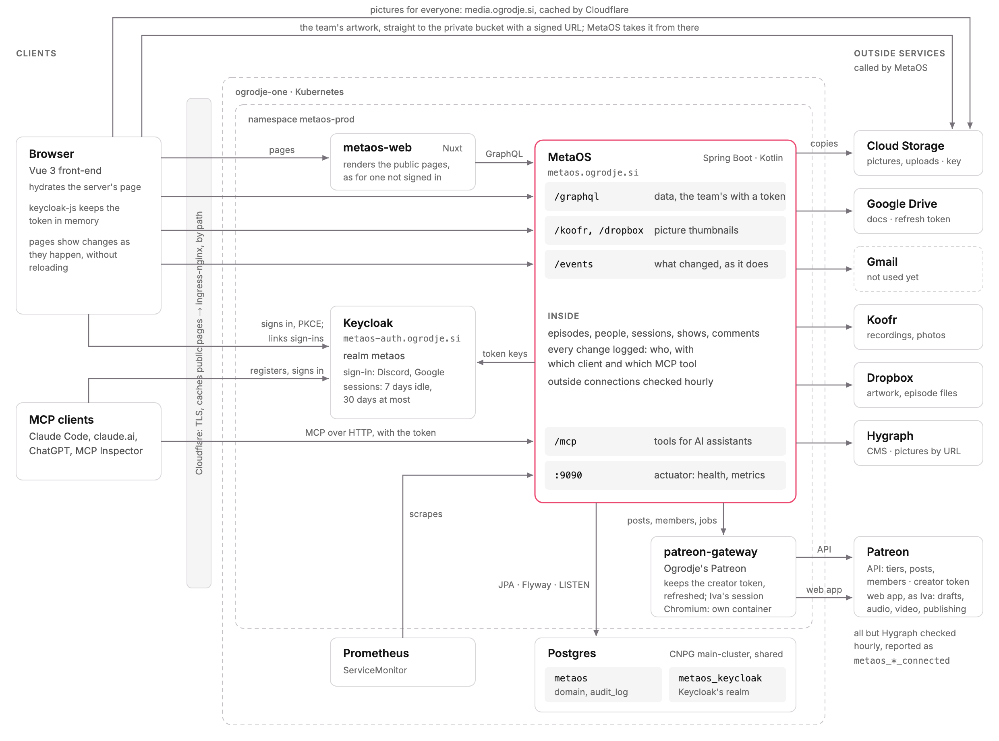
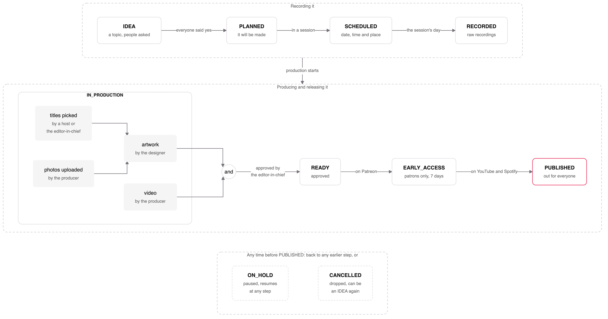

# Ogrodje MetaOS

MetaOS is an autonomous, agentic framework for managing and operating media organisations.

MetaOS was designed for scaling, optimising and helping grow the [Ogrodje] organisation.

## Architecture Overview



People use MetaOS through its web front-end or from an AI assistant over MCP. The front-end is a Nuxt server of its
own, which renders the pages anyone may see from MetaOS's API, so search engines and link previews get them whole,
and Cloudflare caches them; the browser then carries on as a single-page app. Both sign in with [Keycloak], and
MetaOS checks their tokens with Keycloak's keys. MetaOS keeps its data in Postgres, where every change is logged, and
works with Google Drive, Koofr and Dropbox as Ogrodje's bot account. Postgres also tells MetaOS what changed, which it
passes on to the open pages, so they show it without being reloaded. Pictures everyone may see, like episodes'
thumbnails from Dropbox and people's avatars from Hygraph, MetaOS copies to its public bucket in Google Cloud Storage,
from which browsers load them at media.ogrodje.si, cached by Cloudflare; the team uploads an episode's artwork from
its page straight to MetaOS's private bucket, and MetaOS publishes it from there. Everything runs on Ogrodje's
Kubernetes cluster, behind Cloudflare.

The diagram is drawn in [`architecture.svg`](architecture.svg); `just architecture` renders `architecture.png` from it.

## Episode workflow



An episode starts as an idea. Once everyone on it, its hosts, guests and producer, has said yes, it's planned and gets
its code, and then it's scheduled into a recording session, a date, a time and a place, often with other episodes. After
the recording the producer makes its video and uploads its photos, a host or the editor-in-chief picks its titles, and
from those the designer makes its artwork; once the video and the artwork are done and the editor-in-chief approves
them, it's ready. It goes out on Patreon first, and on YouTube and Spotify a week later.

[`docs/episode-workflow.md`](docs/episode-workflow.md) says what each step needs and when Home flags an episode. It's
the source of truth, which MetaOS follows; `just episode-workflow` renders the chart from it.

## Installing MCP

Claude Code (then `/mcp` → ogrodje → Authenticate):

```bash
claude mcp add --transport http --scope user ogrodje https://metaos.ogrodje.si/mcp
```

Claude, on claude.ai or in the desktop app: Settings → Connectors → Add custom connector, with
`https://metaos.ogrodje.si/mcp`, then Connect. Its phone apps use it once it's connected.

Codex (CLI, IDE extension and app; signs in right away, `codex mcp login ogrodje` signs in again):

```bash
codex mcp add ogrodje --url https://metaos.ogrodje.si/mcp
```

ChatGPT, on chatgpt.com in a browser: Plugins → Add → Add custom MCP server, with `https://metaos.ogrodje.si/mcp`,
OAuth and Dynamic Client Registration (DCR). The front-end's Usage page (`/usage`) has the steps for each.

## Development && Infrastructure notes

- This project uses [Nix] and [devenv] for dependency isolation and reproducability.
- The project is written in Kotlin and uses Spring Boot at its core.
- Services and infrastructure is deployed via Kubernetes ([`k8s`](./k8s))

## Authors

- [Oto Brglez](https://github.com/otobrglez)

[Ogrodje]: https://ogrodje.si
[Nix]: https://nixos.org/
[devenv]: https://devenv.sh/
[Keycloak]: https://www.keycloak.org/


