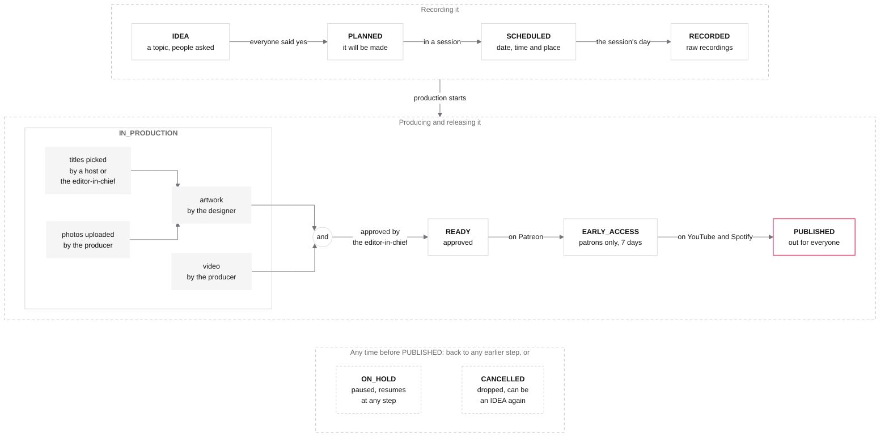

# Episode workflow

How Ogrodje makes an episode, from an idea to its release. This is the source of truth: MetaOS follows it, not the
other way round. To change how episodes are made, change this first, then the code: its statuses and moves
(`EpisodeStatus` in [`Episodes.kt`](../src/main/kotlin/si/ogrodje/metaos/Episodes.kt)), what each status needs
(`set_episode_status` in [`EpisodesMCP.kt`](../src/main/kotlin/si/ogrodje/metaos/EpisodesMCP.kt)) and what Home flags
([`attention.ts`](../fe/src/attention.ts)). Where they still differ is under [Not in the code yet](#not-in-the-code-yet).

The chart is drawn here; `just episode-workflow` renders it into [`episode-workflow.png`](episode-workflow.png), which
the README shows. Render it again whenever it changes, and look at it.

## Words

- **Episode**: one recording, released on Patreon, YouTube and Spotify. It has a code once it's planned (`S05E12`,
  `S99` for bonus episodes), and may be in a **show**, e.g. Borderless or Bytes. A show is only a label: every show's
  episodes are made the same way.
- **Session**: a date, a time and a place where episodes are recorded, often several, e.g. at a conference or in the
  studio.
- **People on an episode**, by role: its hosts and co-hosts, its guests, the producer, who makes its video and
  uploads its photos, the designer, who makes its artwork, and consultants.
- **Editor-in-chief**: Oto Brglez. They pick episodes' titles, as their hosts do, and approve every video and its
  artwork, so they're the only one who moves an episode to READY. MetaOS knows them by their email, as it knows who
  links accounts (`ACCOUNT_LINKER`).
- **Answers**: each host, co-host, guest and producer on an episode is asked first, then says yes or no. Who said no
  stays on the episode, marked as declined, so the team sees who was asked and doesn't ask again by mistake; they
  count for nothing. Designers and consultants aren't asked.
- **The team**: approved users, who see and change all of this, on MetaOS's pages or from an AI assistant over MCP.

## Rules

- An episode moves one step forward along the main path, or back to any earlier step. Before it's published it can
  be put on hold or cancelled, at any time.
- **Needs** block a move. Each status needs what the ones before it did, plus its own, and an episode moves into it
  only when it has them all. They're checked when it moves, not after.
- **Flags** never block. They're what Home lists under Needs attention: what's late, missing or no longer true.
- A status never changes by itself, not even when what it needed stops being true, e.g. when a guest withdraws. Home
  flags it, and someone on the team moves the episode back, on hold, or cancels it, as only they know why.

## Stages

### IDEA

A topic for an episode, on the Ideas page. Anyone on the team adds one, with who recommended it, if someone did, and
it's talked over in its discussion.

The work: find its hosts, a guest or two, unless it's the hosts' own episode, and a producer; put them on the episode
and ask them. Their answers go down as they come.

- Needs: a title.
- Flags: someone was asked 7 days ago and hasn't answered (follow up); someone said no and nobody else is left in
  their role (ask someone else). A guest episode whose guests all said no is flagged until someone else is asked; moved
  on without one, it's the hosts' own.

### PLANNED

Everyone on it said yes: it will be made. It gets its code, the next one in its season.

The work: find it a session.

- Needs: a code, a host and a producer; nobody on it still waiting to answer.
- Flags: someone on it said no after they'd said yes. Move it back to IDEA while someone else is asked, put it on hold
  to wait for them, or cancel it if it was theirs. This flag holds until the episode is recorded.

### SCHEDULED

It's in a session, with its date, time and place: everyone knows when and where it's recorded. Its recording date is
the session's.

The work: the hosts prepare it in a Google Doc, linked to the episode or its session, with its topics and questions;
the guests get the date, the time and the place.

- Needs: a session with a date, a time and a place.
- Flags: the session is in 14 days or less and there's no prep doc, or someone on it hasn't said yes; the session's
  day passed and it's still scheduled (was it recorded?).

### RECORDED

Recorded on the session's day. The raw recordings go to a Koofr folder linked to the session or the episode, or stay
with the producer, who starts on them.

- Needs: a session whose day isn't in the future.
- Flags: recorded 30 days ago and not in early access yet.

### IN_PRODUCTION

Its video and its artwork are made, side by side. It's ready only when both are done:

1. **The video**, by the producer: the recording, edited. The final cut goes up to YouTube as an unlisted video, and
   its link is the episode's YouTube link from then on.
2. **The artwork**, by the designer, from the episode's Dropbox Artwork folder: the thumbnail, the cover for podcast
   apps and the web picture, the thumbnail without its text, for ogrodje.si; and thumbnails B and C for titles B and
   C. Thumbnails and the web picture are 1920 × 1080, the cover 3000 × 3000.

The artwork waits for two things, which the designer makes it from:

- **The titles**, as the pictures carry them: a host or the editor-in-chief picks the title, and titles B and C when
  it's A/B tested on YouTube, each with its own thumbnail, as they're tested together.
- **The photos**: the producer uploads them to a Koofr folder linked to the episode, where MetaOS shows them on its
  page.

MetaOS takes an episode's artwork only once its titles are picked and its photos are there. Meanwhile, its summary and
tiny summary are written.

Then the editor-in-chief watches the unlisted cut and looks at the artwork, and asks for changes or approves them.

- Needs: nothing new; its producer said yes before.
- Flags: recorded 30 days ago and not in early access yet.

### READY

The video and the artwork are done, and the editor-in-chief approved them. They're the only one who moves an episode
here, and its history says they did.

- Needs: the editor-in-chief; the video, its YouTube link; the titles, picked; photos in its Koofr folder; the artwork,
  a thumbnail, a cover and a web picture, and thumbnails B and C for titles B and C; a summary and a tiny summary.
- Flags: recorded 30 days ago and not in early access yet.

### EARLY_ACCESS

On Patreon, for its patrons, 7 days before everyone else. Every episode goes through it.

- Needs: a Patreon link.
- Flags: in early access for over 7 days: due for its public release.

### PUBLISHED

Out for everyone: public on YouTube, and on Spotify, which takes it to podcast apps. It's final: a published episode
doesn't move again. Its aired date is the day it's published, unless it has one.

- Needs: YouTube, Spotify and Patreon links.

Once it's out, the hosts and the team promote it on social networks. MetaOS doesn't keep track of that.

### ON_HOLD

Paused, at any time before it's published, e.g. while a guest can't make it. It comes back to any step before
PUBLISHED, and needs what that step does.

### CANCELLED

Not to be made, decided at any time before it's published. It can only become an idea again. It may keep its code,
which leaves a gap in its season, or give it up for another episode.

## Timings

| What                           | By                          | Else Home flags       |
|--------------------------------|-----------------------------|-----------------------|
| An answer                      | 7 days after being asked    | Follow up             |
| Everyone's yes, and a prep doc | 14 days before the session  | Not confirmed, No doc |
| Early access                   | 30 days after the recording | Not in early access   |
| Public release                 | 7 days after early access   | Due for release       |

## Not in the code yet

Where MetaOS doesn't do what this says yet. Each goes once the code follows; when the list is empty, they agree.

- **Answers**: only guests are asked today, as candidates (`CANDIDATE`, `confirm_guest`), and one who says no is taken
  off. Every host, co-host, guest and producer gets an answer: asked, yes or no, kept when it's no. Those on episodes
  now count as having said yes.
- **PLANNED** needs a producer and nobody still waiting to answer (today a code and a host).
- **SCHEDULED** needs a session with a date, a time and a place, whose date is the recording date (today the
  episode's own recording date). Sessions have no time yet, and may have no place.
- **Titles picked**: titles are only text today. Picking them is kept, with who picked them, which only a host or the
  editor-in-chief does.
- **Artwork waits**: an episode's pictures (`set_episode_image`) wait for its titles to be picked and for photos in its
  Koofr folder (`KoofrPhotos`).
- **READY** is the editor-in-chief's alone, and needs a YouTube link, the titles picked, the photos, the artwork and
  the tiny summary (today a producer and a summary).
- **EARLY_ACCESS** can't be skipped: READY goes only to EARLY_ACCESS (today straight to PUBLISHED too), and when it
  started is kept, for its 7 days.
- **PUBLISHED** needs YouTube, Spotify and Patreon links (today any of YouTube, Spotify or Apple Podcasts).
- **The web picture** isn't an episode picture yet (`EpisodeImage`).
- **Home's flags**: answers overdue, declined with nobody left, withdrawn, everyone's yes and the prep doc 14 days
  ahead, 30 days to early access (today 60 days to release), due for release.
- `set_episode_status`'s description, its line in [`fe/src/tools.ts`](../fe/src/tools.ts), and what CLAUDE.md says
  about Home follow these.
